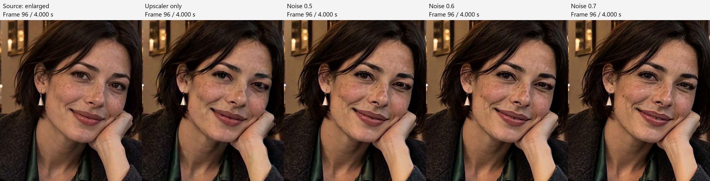
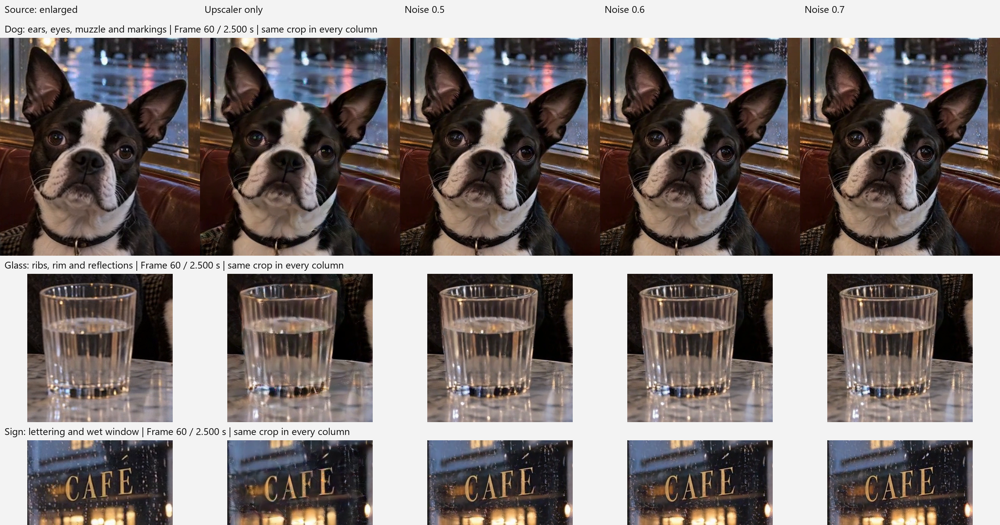

# Olm Open-H3 Regenerate 2K for ComfyUI

Experimental ComfyUI nodes for NVIDIA's
[Open-H3-Regenerate-2K](https://nvlabs.github.io/Sana/Open-H3-Regenerate-2K/).
Upscale and generatively refine video, or refine existing MiniMax-H3 latents.

Created by [Olli Sorjonen](https://github.com/o-l-l-i) · [X](https://x.com/Olmirad)

**Details can change:** faces, shading, jewelry, lettering and markings may be
redrawn. Compare the result with your source when fidelity matters.

## Installation

From your ComfyUI `custom_nodes` directory:

```sh
git clone https://github.com/o-l-l-i/ComfyUI-Olm-Open-H3-Regenerate-2K.git
```

- No extra Python packages are needed in the tested ComfyUI environment.
- Use a recent ComfyUI with native MiniMax-H3, V3 nodes and block-sparse attention.
  Keep its dependencies updated with ComfyUI itself.
- Tested: Windows, ComfyUI 0.43.0, Comfy Kitchen 0.2.40, Python 3.13,
  PyTorch 2.13 / CUDA 13, RTX 5090 (32 GB VRAM), 128 GB system RAM.
- Physical 16/24 GB cards and other operating systems have not been validated.

## Models

Download these files from the three repositories below. Use the **pruned FL2VA** base.

**From [Comfy-Org/MiniMax-H3](https://huggingface.co/Comfy-Org/MiniMax-H3):**

- [`diffusion_models/`](https://huggingface.co/Comfy-Org/MiniMax-H3/tree/main/diffusion_models): `minimax_h3_fl2va_pruned_int8_convrot.safetensors`
- [`text_encoders/`](https://huggingface.co/Comfy-Org/MiniMax-H3/tree/main/text_encoders): `qwen3vl_32b_minimax_h3_nvfp4_awq.safetensors`
- [`vae/`](https://huggingface.co/Comfy-Org/MiniMax-H3/tree/main/vae): `minimax_h3_video_vae_fp16.safetensors`
- [`vae/`](https://huggingface.co/Comfy-Org/MiniMax-H3/tree/main/vae): `minimax_h3_audio_vae_fp32.safetensors`

**From [LBH-123-AI/Minimax_h3_latent_Upscaler](https://huggingface.co/LBH-123-AI/Minimax_h3_latent_Upscaler):**

- [`minimax_h3_latent_upscaler_3d_conv_v1/`](https://huggingface.co/LBH-123-AI/Minimax_h3_latent_Upscaler/tree/main/minimax_h3_latent_upscaler_3d_conv_v1): `minimax_h3_latent_upscaler_3d_conv_v1_bf16.safetensors`

**From [NVIDIA's Open-H3-Regenerate-2K adapters](https://huggingface.co/Efficient-Large-Model/Open-H3-Regenerate-2K/tree/main/lora), in `lora/`:**

- `open_h3_regenerate_2k_lora.safetensors`
- `sharp_curve_branches.safetensors`

Only these two files are needed from NVIDIA's large model repository. Fetch
`adaln_t_table.bin` separately with the helper below.

**Paths are not hard-coded.** Existing ComfyUI model folders and
`extra_model_paths.yaml` work, including models on another drive.

Suggested **local** locations under `ComfyUI/models/`:

| Folder | File | GiB |
| --- | --- | ---: |
| `diffusion_models/` | `minimax_h3_fl2va_pruned_int8_convrot.safetensors` | 19.53 |
| `text_encoders/` | `qwen3vl_32b_minimax_h3_nvfp4_awq.safetensors` | 14.61 |
| `vae/` | `minimax_h3_video_vae_fp16.safetensors` | 4.85 |
| `vae/` | `minimax_h3_audio_vae_fp32.safetensors` | 0.56 |
| `latent_upscale_models/` | `minimax_h3_latent_upscaler_3d_conv_v1_bf16.safetensors` | 0.64 |
| `open_h3_refiner/` | Adapter bundle below | 12.75 |

Keep the adapter bundle's internal structure:

```text
open_h3_refiner/Open-H3-Regenerate-2K/lora/
    open_h3_regenerate_2k_lora.safetensors
    sharp_curve_branches.safetensors
    adaln_t_table.bin
```

Fetch the small Sharp timestep table from the extension directory, using your
ComfyUI Python:

```powershell
python scripts/fetch_sharp_table.py --output ../../models/open_h3_refiner/Open-H3-Regenerate-2K/lora/adaln_t_table.bin
```

- The helper downloads only the table and header data, verifies the checksum, and
  refuses a full-checkpoint response.
- Already have the native INT8 Ref2VA checkpoint? Add
  `--source-model PATH_TO_REF2VA.safetensors` to extract the table locally.
- Upscalers can also live under registered diffusion-model roots. Adapter roots
  can be `open_h3_refiner`, `diffusers`, or this extension's `weights` folder;
  each root contains the bundle folder.
- Restart ComfyUI after setup or path changes. Nodes load local files only.

Optional `extra_model_paths.yaml` example (fictional paths; replace with your own):

```yaml
open_h3_models:
  open_h3_refiner: X:/my_models
  open_h3_upscalers: X:/my_models/latent_upscale_models
```

- `open_h3_refiner` points to the **parent of the bundle**, for example
  `X:/my_models/Open-H3-Regenerate-2K/lora/` beneath the root above.
- `open_h3_upscalers` points to the folder containing the upscaler files.
- The group name `open_h3_models` is arbitrary. Base models, text encoders and
  VAEs use ComfyUI's usual path keys. No extra entry is needed for files already found.

## Usage

Open the [video workflow](workflows/video_refinement.json):

1. **Load Video → Get Video Components:** upload/select your video.
2. **Open-H3 Refiner Loader (Olm):** select your local models and adapters.
3. **Open-H3 Refine Video (Olm):** describe the scene and choose the output size.
4. **Create Video → Save Video:** use the refiner's output `fps` and the original audio.

- **Output is 24 fps.** Other input rates are converted by dropping/repeating
  frames, preserving duration to the nearest output frame. No motion interpolation.
- Exact 24 fps input keeps its frame count. Longer clips use independent windows
  and may show visible boundaries. Up to 124 frames fit in one default window.
- Older workflows: connect the refiner's new `fps` output to **Create Video**,
  or set **Create Video** to **24**. Keep the actual input rate connected to the refiner.
- Audio is fixed conditioning, not regenerated. Route it separately to Create Video.
- The [native-latent workflow](workflows/native_latent_refinement.json) avoids
  re-encoding H3 video/AV latents on the 5–124-frame grids and returns images
  plus AV latents. Replace its saved-latent inputs with your files; connect the
  original soundtrack for video with sound. Use the frame node for longer clips.

| Setting | Notes |
| --- | --- |
| `schedule` | Start with **Custom / 2 steps / noise 0.5**. NVIDIA 2/3-step presets and **Upscaler only** are also available. |
| Width / height | At least 256 px, multiples of 32. Match your source aspect ratio; frames are resized/center-cropped. |
| `input_size` | 768p default; 576p is also available. |
| `window_frames` | 121 default; 90, 56 or 22 reduce context and working memory. Quality may change. |
| `vae_tile_size` | 256 default. Smaller 192/128 tiles reduce working memory but can affect texture and seams. |
| `text_encoder_device` | `auto` or `cpu`. CPU encoding is slower and uses substantial system RAM. |
| `conditioning` | Optional H3 conditioning bypasses internal text encoding. |
| `sparse_attention` | Enabled by default. Dense attention can use much more memory. |

## Café example

[Source, 1344×768](assets/cafe/source.mp4) ·
[Refined 2K, noise 0.5](assets/cafe/refined_noise_050.mp4)

The slow camera move, faces, fabric, glass and signage provide different details
to inspect. Compare against the **source video**. Watch the clips for motion
artifacts—stills cannot show temporal consistency.


Frame 24 / 1.000 s. Source enlarged with Lanczos for display; output at 2K.
Click the images for full-size inspection.



Frame 96 / 4.000 s. Upscale-only already changes some eyelid, mouth and cheek
shading. Diffusion adds texture while also redrawing small features.



Frame 60 / 2.500 s. Check eye/muzzle shapes, glass ribs and letter edges.
Output crops are lossless PNGs before video encoding, with identical crop
coordinates and no extra sharpening or individual alignment.

- Start at **0.5**, and compare with **Upscaler only**. Both can change details.
- Try **0.6 / 0.7** for stronger regeneration; lower noise if shapes drift.
  Keep the seed and VAE tiles fixed while comparing.
To sanity-check your setup:

1. Open the [video workflow](workflows/video_refinement.json), upload
   `assets/cafe/source.mp4` in **Load Video**, and select your installed models.
2. Keep the supplied café prompt, seed **1766580932**, 2560×1440, 2 steps,
   noise **0.5**, 768p input, 121-frame windows, VAE tiles 256 and sparse attention.
3. Compare with the packaged refined clip and images at frames **24, 60 and 96**
   (zero-based). Hardware and ComfyUI versions can affect the result; identical
   pixels are not guaranteed.

[Prompt](assets/cafe/prompt.txt) · [Settings](assets/cafe/settings.json).
The source clip was generated with MiniMax-H3; the workflow refines this supplied
video and does not require regenerating it.

## Memory

- Start with short clips. Tested on **32 GB VRAM / 128 GB RAM**; smaller cards
  remain unvalidated. ComfyUI manages offloading between stages.
- For less working memory, try **22-frame windows**, **128 px VAE tiles**, lower
  output resolution, and CPU text encoding or supplied conditioning.
- Reducing steps mainly saves time. Dynamic loading can fill available VRAM;
  observed usage is not a fixed minimum requirement.
- **Shorter windows do not reduce the final image batch's RAM:** about **5 GiB for
  121 frames at 2K**, or **59 GiB for one minute at 24 fps**, before models,
  source frames and working memory. The `memory_info` output estimates this batch.
- **64 GB system RAM can be tight**, especially with CPU text encoding.

## Updates

- **2026-10-31:** Other input frame rates now convert to 24 fps by dropping/repeating
  frames. The updated example connects the refiner's output `fps` to Create Video.
- **2026-10-30:** Fixed SwiGLU channel ordering when loading NVIDIA's adapters.
  Demo media is from the initial release; changes in the tested clip were subtle.

## Credits and license

- Model and recipe: [NVIDIA / Sana](https://github.com/NVlabs/Sana/tree/sol-engine/models/Open-H3-Regenerate-2K).
- Native H3: [ComfyUI](https://github.com/Comfy-Org/ComfyUI).
- Learned upscaler: [LBH-123-AI](https://github.com/LBH-123-AI/Comfyui_Minimax_h3_latent_Upscaler).
- The adapter includes LightX2V Turbo and LMS Sharp; their terms are linked from
  the publisher's model card.

Original integration code is source-available under [LICENSE.txt](LICENSE.txt).
See [third-party notices](THIRD_PARTY_NOTICES.md) for attribution. Model licenses
are separate; weights and the Sharp table are not bundled.
