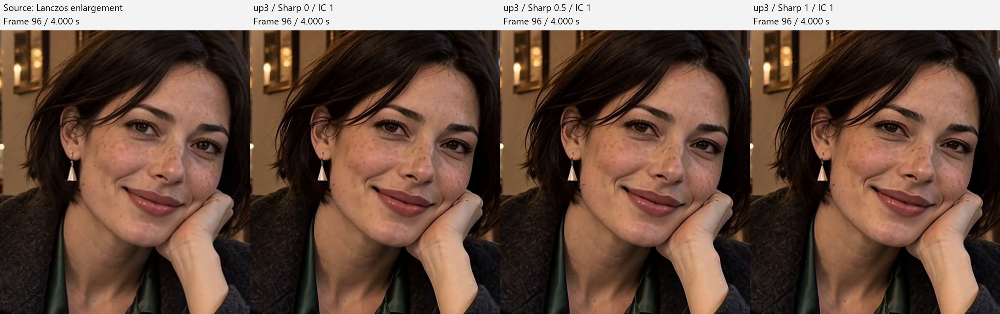
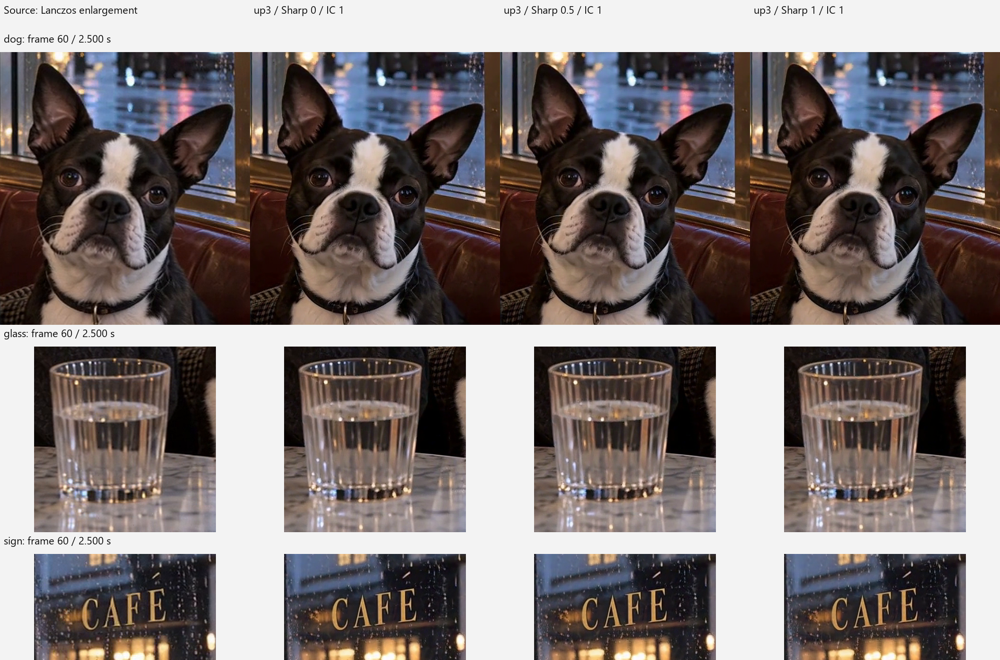
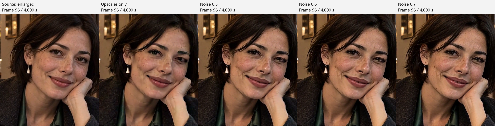
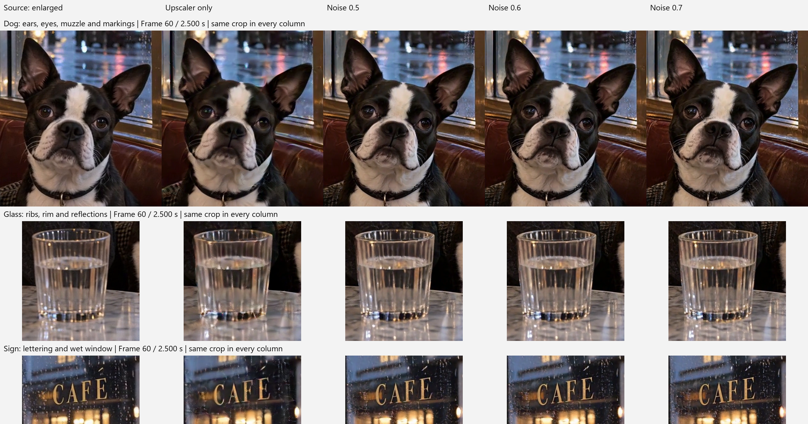

# Olm Open-H3 Regenerate 2K for ComfyUI

Experimental ComfyUI nodes for NVIDIA's
[Open-H3-Regenerate-2K](https://nvlabs.github.io/Sana/Open-H3-Regenerate-2K/).
Upscale and generatively refine video using the newer **IC / Ref2VA** recipe,
or use the original **FL2VA** video and latent workflows.

Created by [Olli Sorjonen](https://github.com/o-l-l-i) · [X](https://x.com/Olmirad)

- **Start with IC:** it uses the source video as a reference during refinement.
- **Details can still change:** faces, shading, jewelry, lettering and markings
  may be redrawn. Compare with your source when fidelity matters.
- **IC setup includes a one-time script:** about **26 GB of network transfer**
  creates a **185 MiB local timestep file**, in addition to the model downloads.
- Tested on **Windows / RTX 5090 32 GB / 128 GB RAM**. Physical 16/24 GB cards
  and other operating systems have not been validated.

[IC example](#ic-café-example) · [Installation](#installation) ·
[IC models and setup](#ic-models-and-setup) · [Usage](#usage) ·
[Original method](#original-fl2va-method) · [Memory](#memory)

## IC café example

[Source, 1344×768](assets/cafe/source.mp4) ·
[IC output, 2560×1440 — 13.2 MB](assets/cafe/ic_up3.mp4) ·
[Settings](assets/cafe/ic_settings.json)

Same café clip, **up3 / IC 1**, with Sharp 0, 0.5 and 1. The linked output uses
**Sharp 1**. Click the images for full-size inspection.



Frame 96 / 4.000 s. Compare eyelids, cheek shading, freckles and the earring.
Sharp changes fine contrast and regenerated features; it is not just an output
sharpening filter. A lower value is not necessarily more faithful.



Frame 60 / 2.500 s. Fur and glass gain definition, while small shapes and shading
also change. These are matching crops from PNGs saved before video compression;
the source is enlarged with Lanczos, with no extra sharpening or alignment.
Watch the clips too: stills cannot establish temporal consistency.

To repeat the example, upload `assets/cafe/source.mp4` using the
[IC workflow](workflows/ic_video_refinement.json), select your models and keep
its saved settings: seed **1766580932**, **2560×1440**, **up3**, **IC 1 / Sharp 1**,
768p input, 121-frame windows, VAE tiles 256 and sparse attention. The
[café prompt](assets/cafe/prompt.txt) is already filled in. Results may vary with
hardware and ComfyUI versions.

## Installation

1. Update ComfyUI and its dependencies. Native MiniMax-H3, V3 nodes and
   block-sparse attention are required.
2. From your ComfyUI `custom_nodes` directory, run:

   ```sh
   git clone https://github.com/o-l-l-i/ComfyUI-Olm-Open-H3-Regenerate-2K.git
   ```

3. Download the models and complete the one-time IC setup below.
4. Restart ComfyUI, then drag the [IC workflow](workflows/ic_video_refinement.json)
   into its canvas and select your local files in **Open-H3 IC Loader (Olm)**.

- No extra Python packages are needed in the tested ComfyUI environment.
- Tested with ComfyUI 0.44.0-33, Kitchen 0.2.41, aimdo 0.6.0, frontend 1.58.5,
  Python 3.13 and PyTorch 2.13 / CUDA 13.
- Already installed? Update this custom node as well as ComfyUI, then restart.
  Existing original-method workflows remain supported.

## IC models and setup

### 1. Download the model files

Download the **individual files**, not whole repositories. Suggested destinations
below are relative to **`ComfyUI/models/`**. Create missing folders. Existing
copies of the shared text encoder, video VAE and upscaler can be reused.

**From [Comfy-Org/MiniMax-H3](https://huggingface.co/Comfy-Org/MiniMax-H3):**

| Repository folder | File | Put it in |
| --- | --- | --- |
| [diffusion_models](https://huggingface.co/Comfy-Org/MiniMax-H3/tree/main/diffusion_models) | `minimax_h3_ref2va_pruned_int8_convrot.safetensors` | `diffusion_models/` |
| [text_encoders](https://huggingface.co/Comfy-Org/MiniMax-H3/tree/main/text_encoders) | `qwen3vl_32b_minimax_h3_nvfp4_awq.safetensors` | `text_encoders/` |
| [vae](https://huggingface.co/Comfy-Org/MiniMax-H3/tree/main/vae) | `minimax_h3_video_vae_fp16.safetensors` | `vae/` |

**From [LBH-123-AI/Minimax_h3_latent_Upscaler](https://huggingface.co/LBH-123-AI/Minimax_h3_latent_Upscaler/tree/main/minimax_h3_latent_upscaler_3d_conv_v1):**

- In `minimax_h3_latent_upscaler_3d_conv_v1/`, download
  `minimax_h3_latent_upscaler_3d_conv_v1_bf16.safetensors`.
- Put it in `latent_upscale_models/`.

**From [NVIDIA's IC model repository](https://huggingface.co/Efficient-Large-Model/Open-H3-Regenerate-2K-IC/tree/54a7104b204fb46486cf85c2f600942118186d57):**

| Repository folder | File | Put it in |
| --- | --- | --- |
| [lora](https://huggingface.co/Efficient-Large-Model/Open-H3-Regenerate-2K-IC/tree/54a7104b204fb46486cf85c2f600942118186d57/lora) | `open_h3_regenerate_2k_ic_lora.safetensors` | `open_h3_refiner/Open-H3-Regenerate-2K-IC/lora/` |
| [lora](https://huggingface.co/Efficient-Large-Model/Open-H3-Regenerate-2K-IC/tree/54a7104b204fb46486cf85c2f600942118186d57/lora) | `minimax_h3_hyperflow_8step_v1.0.safetensors` | Same `lora/` folder |
| [lora](https://huggingface.co/Efficient-Large-Model/Open-H3-Regenerate-2K-IC/tree/54a7104b204fb46486cf85c2f600942118186d57/lora) | `minimax_h3_lms_v1.0_r64.safetensors` | Same `lora/` folder |
| [assets](https://huggingface.co/Efficient-Large-Model/Open-H3-Regenerate-2K-IC/tree/54a7104b204fb46486cf85c2f600942118186d57/assets) | `silence_audio_124f.safetensors` | `open_h3_refiner/Open-H3-Regenerate-2K-IC/assets/` |

IC does **not** need the original FL2VA model, audio VAE, original refiner bundle,
separate Sharp table or Fast VAE v2. The source soundtrack is passed through.

### 2. Prepare the timestep file once

**Why:** the native pruned Ref2VA model needs additional timestep data for IC's
HyperFlow sampling. The included script computes it from selected original
checkpoint tensors. It does not quantize or modify your downloaded models.

- Run this **after downloading the IC files above**, using **ComfyUI's Python**.
  A separate system Python may not have the required packages.
- Needs internet for about **26 GB of transfer**, once per prepared bundle.
  It reads selected data and does **not** save a full original checkpoint.
- Creates **`ic_time.safetensors` (~185 MiB)** and a temporary/resumable
  **`.ic_time_cache` (~185 MiB)** inside the bundle. Preparation runs on CPU.
- This is separate from video generation: nodes load local files and never run
  the download/conversion automatically.

**Windows venv installation:** open PowerShell in your **ComfyUI folder**
(the folder containing `main.py` and `venv`), then run:

```powershell
& .\venv\Scripts\python.exe .\custom_nodes\ComfyUI-Olm-Open-H3-Regenerate-2K\scripts\prepare_ic.py --bundle .\models\open_h3_refiner\Open-H3-Regenerate-2K-IC
```

**Windows portable:** open PowerShell in the **portable folder**
(containing `python_embeded` and `ComfyUI`), then run:

```powershell
& .\python_embeded\python.exe .\ComfyUI\custom_nodes\ComfyUI-Olm-Open-H3-Regenerate-2K\scripts\prepare_ic.py --bundle .\ComfyUI\models\open_h3_refiner\Open-H3-Regenerate-2K-IC
```

These commands assume the folder layout above. For models elsewhere, replace
the `--bundle` value with your bundle's path, for example
`--bundle "X:/my_models/Open-H3-Regenerate-2K-IC"`.

**When finished**, the script prints `Prepared ... ic_time.safetensors`.
Your bundle should contain:

```text
ComfyUI/models/open_h3_refiner/Open-H3-Regenerate-2K-IC/
    lora/
        open_h3_regenerate_2k_ic_lora.safetensors
        minimax_h3_hyperflow_8step_v1.0.safetensors
        minimax_h3_lms_v1.0_r64.safetensors
    assets/
        silence_audio_124f.safetensors
    ic_time.safetensors
```

- **Interrupted?** Run the same command again; it reuses completed cached
  projections. Leave `.ic_time_cache` in place until setup succeeds.
- **Finished?** Keep `ic_time.safetensors`. You can delete `.ic_time_cache`.
  Do not rerun setup for each clip or when switching between `up3` and `up4`.
  The script refuses to overwrite an existing timestep file.
- **Already have the original checkpoint?** Add
  `--source-directory "X:/my_models/transformer_ref"` to use its original shards
  and index offline. The native pruned INT8 file cannot replace those shards.

### 3. Restart and select your models

Restart ComfyUI and open the [IC workflow](workflows/ic_video_refinement.json).
In **Open-H3 IC Loader (Olm)**, select the Ref2VA model, Qwen encoder, video VAE,
upscaler and `Open-H3-Regenerate-2K-IC` bundle. Folder placement lets ComfyUI find
the files; the loader selections determine which ones it uses.

<details>
<summary>Using models on another drive / extra_model_paths.yaml</summary>

**Paths are not hard-coded.** Existing ComfyUI model roots work. This is an
optional example with fictional paths; replace them with your own:

```yaml
open_h3_models:
  open_h3_refiner: X:/my_models
  open_h3_upscalers: X:/my_models/latent_upscale_models
```

- `open_h3_refiner` points to the **parent of the bundle**, so the IC bundle above
  would be `X:/my_models/Open-H3-Regenerate-2K-IC/`.
- `open_h3_upscalers` points to the folder containing the upscaler files.
- The group name `open_h3_models` is arbitrary. Base models, encoders and VAEs
  use ComfyUI's usual `diffusion_models`, `text_encoders` and `vae` keys.
- No extra entry is needed for files already found. Restart after path changes.

</details>

## Usage

1. **Load Video:** upload your source clip.
2. **IC Loader:** select the files prepared above.
3. **IC Refine Video:** choose the output size. Replace or clear the example's
   café prompt; a scene description is optional. The enhancement instruction is automatic.
4. **Create Video → Save Video:** keep the refiner's output `fps` connected,
   and route the original audio from **Get Video Components** to **Create Video**.

| Setting | Starting point / effect |
| --- | --- |
| `sampler` | **up3**, three Euler steps. `up4` uses four steps and higher starting noise. |
| `ic_strength` | **1**. Scales the IC adapter; lower is not necessarily more faithful. |
| `sharp_strength` | **1**; try **0.5** or **0** for comparison. Changes only LMS Sharp. |
| Width / height | Multiples of 32, at least 256. Match the source aspect ratio; input is resized/center-cropped. |
| `input_size` | **768p**; 576p is also available. |
| `window_frames` | **121**; 90, 56 or 22 reduce context and working memory. |
| `vae_tile_size` | **256**; 192/128 reduce working memory but may change texture/seams. |
| `text_encoder_device` | **auto**; CPU encoding is slower and uses substantial RAM. |
| `sparse_attention` | **On**. Dense attention can use much more memory. |

- Output is **24 fps**. Other input rates use frame dropping/repeating, preserving
  duration to the nearest output frame. No motion interpolation.
- Up to **124 frames** fit in one default window. Longer clips use independent
  windows and **may show seams**; there is no temporal blending.
- IC uses fixed silent audio internally; it does not generate or refine your soundtrack.
- Start with **IC 1 / Sharp 1 / up3**. Compare faces, jewelry and lettering with
  your source, keeping the seed and VAE tiles fixed while changing one control.
- In this café test, IC 0.75/1/1.25 had no consistent fidelity winner. `up4` changed
  details without a clear fidelity gain and took about 22% longer than `up3`.

<details>
<summary>How this compares with NVIDIA's IC recipe</summary>

- Same published `up3` schedule: **0.834942 → 0.696852 → 0.468753 → 0**.
- Same `up4` schedule: **0.923077 → 0.834942 → 0.696852 → 0.468753 → 0**.
- CFG 1 (guidance off), HyperFlow strength fixed at 1, IC and Sharp default to 1.
  IC strength is adjustable here; at zero, the Ref2VA reference, HyperFlow and any
  Sharp remain active. This does not switch to the original FL2VA method.
- Native ComfyUI INT8 model, quantized Qwen encoder and offloading; precomputed
  timestep projections for the fixed schedules.
- Standard **FP16 tiled video VAE**, with mean encoding. NVIDIA's reference
  samples the VAE posterior and defaults to Fast VAE v2. Outputs can differ.
- Fast VAE v2, custom IC schedules and eight-step mode are not included.

</details>

## Memory

- Start with short clips. Tested on **32 GB VRAM / 128 GB RAM**; smaller cards
  remain unvalidated. ComfyUI manages offloading between stages.
- A 124-frame 2K IC workflow took **4m10s** end to end on the 5090, peaking at
  **28.8 GiB total GPU usage** and **35.3 GiB resident RAM** (66.5 GiB Windows
  private commitment), with sparse attention and `--reserve-vram 6`.
  This measurement used ComfyUI 0.44.0-12; it is not a minimum VRAM requirement.
- For less working memory, try **22-frame windows**, **128 px VAE tiles**, lower
  output resolution and CPU text encoding. Reducing steps mainly saves time.
- **Shorter windows do not reduce the final image batch's RAM:** about **5.1 GiB
  for 124 frames at 2K**, or **59 GiB for one minute**, before models, source frames
  and working memory. The `memory_info` output estimates this batch.
- **64 GB system RAM can be tight**, especially with CPU text encoding.

## Original FL2VA method

The original nodes remain available for comparison and existing workflows:
[video refinement](workflows/video_refinement.json) ·
[native latent refinement](workflows/native_latent_refinement.json).
IC's setup and adapters are separate; you do not need both methods installed.

<details>
<summary>Original model downloads and setup</summary>

Reuse the Qwen encoder, FP16 video VAE and BF16 upscaler listed above. Also download:

| Repository / folder | File | Destination under ComfyUI/models/ |
| --- | --- | --- |
| [Comfy-Org/MiniMax-H3 / diffusion_models](https://huggingface.co/Comfy-Org/MiniMax-H3/tree/main/diffusion_models) | `minimax_h3_fl2va_pruned_int8_convrot.safetensors` | `diffusion_models/` |
| [Comfy-Org/MiniMax-H3 / vae](https://huggingface.co/Comfy-Org/MiniMax-H3/tree/main/vae) | `minimax_h3_audio_vae_fp32.safetensors` | `vae/` |
| [NVIDIA original / lora](https://huggingface.co/Efficient-Large-Model/Open-H3-Regenerate-2K/tree/main/lora) | `open_h3_regenerate_2k_lora.safetensors` | `open_h3_refiner/Open-H3-Regenerate-2K/lora/` |
| [NVIDIA original / lora](https://huggingface.co/Efficient-Large-Model/Open-H3-Regenerate-2K/tree/main/lora) | `sharp_curve_branches.safetensors` | Same `lora/` folder |

Fetch the small Sharp table separately, once. For a venv installation, run from
your **ComfyUI folder** using its Python:

```powershell
& .\venv\Scripts\python.exe .\custom_nodes\ComfyUI-Olm-Open-H3-Regenerate-2K\scripts\fetch_sharp_table.py --output .\models\open_h3_refiner\Open-H3-Regenerate-2K\lora\adaln_t_table.bin
```

For portable installs, use `python_embeded/python.exe` and the `ComfyUI/` path
prefix as in the IC setup command. The helper fetches only the table/header,
checks its checksum and refuses a full-checkpoint response. If you already have
the native INT8 Ref2VA model, add `--source-model "PATH_TO_REF2VA.safetensors"`
to extract the table locally. Restart ComfyUI afterward.

Select **Refiner Loader** and **Refine Video** for this method. Start with
**Custom / 2 steps / noise 0.5**; compare with **Upscaler only**. Try 0.6/0.7 for
stronger regeneration and lower noise if shapes drift. NVIDIA presets are also available.

The native-latent workflow avoids re-encoding H3 video/AV latents on the
5–124-frame grids and returns images plus AV latents. Select your saved latents
and connect the original soundtrack for sound. Use the frame node for longer clips.

</details>

<details>
<summary>Original café results — FL2VA, not IC</summary>

[Source](assets/cafe/source.mp4) ·
[Original 2K output, noise 0.5](assets/cafe/refined_noise_050.mp4) ·
[Settings](assets/cafe/settings.json)




Upscale-only already changes some eyelid, mouth and cheek shading. Diffusion
adds texture while redrawing small features.



These images and the original output are retained from the first release.
The later SwiGLU correction produced only subtle differences in this clip.

</details>

## Updates

- **IC update:** separate Ref2VA loader/refinement nodes, adjustable IC and Sharp
  strengths, up3/up4 sampling, one-time timestep preparation and IC café examples.
  Original workflows also have updated Create Video widget settings.
- **2026-10-31:** Input frame rates convert to 24 fps by dropping/repeating frames.
- **2026-10-30:** Fixed SwiGLU channel ordering when loading NVIDIA's adapters.

## Credits and license

- Model and recipe: [NVIDIA / Sana](https://github.com/NVlabs/Sana/tree/sol-engine/models/Open-H3-Regenerate-2K).
- Native H3: [ComfyUI](https://github.com/Comfy-Org/ComfyUI).
- Learned upscaler: [LBH-123-AI](https://github.com/LBH-123-AI/Comfyui_Minimax_h3_latent_Upscaler).
- Original adapter bundle: LightX2V FL2VA Turbo and LMS Sharp.
- IC recipe: HyperFlow, the IC LoRA and separately adjustable LMS Sharp.

Integration code is source-available under [LICENSE.txt](LICENSE.txt).
See [third-party notices](THIRD_PARTY_NOTICES.md) for attribution. Model licenses
are separate; weights, the Sharp table and derived timestep data are not bundled.
